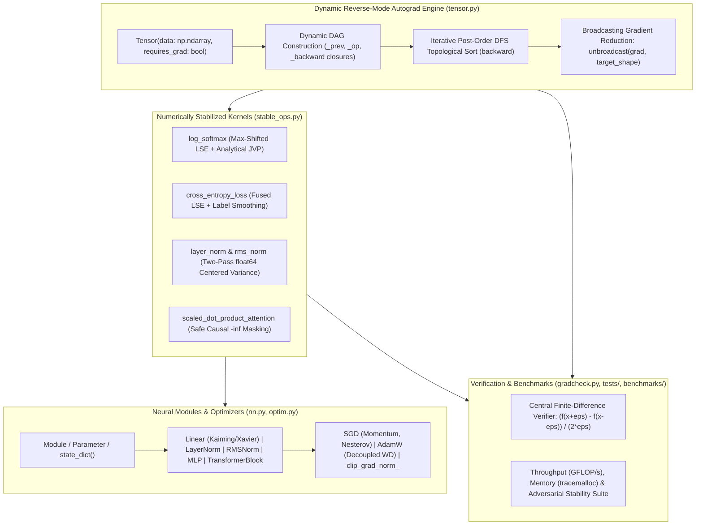

# `tensor-forge`: Reverse-Mode Autodiff & Numerical Stability Engine

[](https://github.com/Aanuoluwapo1/tensor-forge/actions/workflows/ci.yml)
[](https://www.python.org/downloads/)
[](https://numpy.org/)
[](https://opensource.org/licenses/MIT)

**`tensor-forge`** is a production-grade, pure-Python + NumPy numerical computing and reverse-mode automatic differentiation engine engineered from first principles. It implements a dynamic Directed Acyclic Graph (DAG) autograd engine with iterative topological sorting, arbitrary rank- and axis-broadcasting gradient reduction (`unbroadcast`), central finite-difference verification (`numerical_gradient_check`), and numerically stabilized neural network kernels (`log_softmax`, `cross_entropy_loss`, `layer_norm`, `rms_norm`, `scaled_dot_product_attention`) hardened against `NaN`/`Inf` overflow, underflow, and catastrophic cancellation.

Zero runtime dependencies on PyTorch, JAX, or TensorFlow — powered strictly by **Python 3.12+** and **NumPy >= 2.0**.

---

## Architecture Overview



---

## Mathematical Foundations & Derivations

### 1. Broadcasting Gradient Reduction (`unbroadcast`)

When a forward binary operation $C = f(A, B)$ broadcasts an input tensor $A \in \mathbb{R}^{s_1 \times \dots \times s_k}$ to an output shape $S_{\mathrm{out}} = (d_1, \dots, d_m)$ with $m \ge k$, NumPy implicitly:
1. Prepends $m - k$ singleton dimensions of size $1$ on the left of $A$'s shape:
   $$\tilde{S}_A = (\underbrace{1, \dots, 1}_{m-k}, s_1, \dots, s_k)$$
2. Replicates $A$ along every axis $j \in [1, m]$ where $\tilde{s}_j = 1$ and $d_j \gt 1$.

By the multivariate chain rule, a single scalar entry of $A$ contributes additively to all replicated positions along the broadcasted axes in $C$. Therefore, given upstream gradient $G = \frac{\partial L}{\partial C} \in \mathbb{R}^{d_1 \times \dots \times d_m}$, `unbroadcast(G, A.shape)` computes the exact pullback:

$$\frac{\partial L}{\partial A} = \mathrm{reshape}_{S_A}\left(\sum_{j \in J_{\mathrm{sing}}} \sum_{i=1}^{m-k} G\right), \quad J_{\mathrm{sing}} = \left[\, j \in [m-k+1, m] : \tilde{s}_j = 1 \text{ and } d_j \gt 1 \,\right]$$

### 2. Stabilized Log-Sum-Exp (`log_softmax`) & Fused `cross_entropy_loss`

Evaluating $\log(\mathrm{softmax}(x)_i) = \log\left(\frac{e^{x_i}}{\sum_j e^{x_j}}\right)$ naively overflows to $\log(\infty / \infty) = \mathrm{NaN}$ in `float64` whenever $\max_j x_j \gt 709.78$ (and in `float32` whenever $\max_j x_j \gt 88.72$). Shifting by $c = \max_j x_j$ yields the exact identity:

$$\mathrm{logsoftmax}(x)_i = (x_i - c) - \log\left(\sum_{j=1}^{K} \exp(x_j - c)\right), \quad c = \max_{1 \le j \le K} x_j$$

Since $x_j - c \le 0$ for all $j$ and equals $0$ for at least one index $j^*$, every exponential satisfies $\exp(x_j - c) \in [0, 1]$ and the sum is bounded in $[1, K]$, completely eliminating overflow and denominator underflow.

**Analytical Backward Pass (Jacobian-Vector Product):**
With $p_i = \mathrm{softmax}(x)_i = \frac{\exp(x_i - c)}{\sum_j \exp(x_j - c)}$ and upstream gradient $g_i = \frac{\partial L}{\partial y_i}$:

$$\frac{\partial y_k}{\partial x_i} = \delta_{ik} - p_i \implies \frac{\partial L}{\partial x_i} = \sum_{k=1}^{K} g_k (\delta_{ik} - p_i) = g_i - p_i \sum_{k=1}^{K} g_k$$

For fused **Cross-Entropy Loss** with smoothed target distribution $\tilde{y}_i = (1 - \epsilon) y_i + \frac{\epsilon}{K}$ over $N$ examples, substituting $g_k = -\frac{1}{N}\tilde{y}_k$ and $\sum_{k=1}^{K} \tilde{y}_k = 1$ gives the exact, cancellation-free analytical gradient:

$$\frac{\partial L_{\mathrm{CE}}}{\partial x_i} = \frac{1}{N}\left(p_i - \tilde{y}_i\right)$$

### 3. Two-Pass Compensated `LayerNorm` & Analytical Backward Projection

Naive one-pass variance $\mathrm{Var}(x) = \mathbb{E}[x^2] - (\mathbb{E}[x])^2$ suffers catastrophic cancellation when $(\mathbb{E}[x])^2 \gg \mathrm{Var}(x)$ (for instance, in `float32` with offset $10^7$, $\mathbb{E}[x^2] - (\mathbb{E}[x])^2$ evaluates to $-8388608.0 \lt 0$, causing $\sqrt{\mathrm{Var}(x) + \epsilon} = \mathrm{NaN}$).

`tensor-forge` accumulates in `float64` using a two-pass centered formulation over feature dimension $D$:

$$\mu = \frac{1}{D}\sum_{i=1}^{D} x_i, \qquad \sigma^2 = \frac{1}{D}\sum_{i=1}^{D} (x_i - \mu)^2, \qquad r = (\sigma^2 + \epsilon)^{-1/2}, \qquad \hat{x}_i = (x_i - \mu) r, \qquad y_i = \gamma_i \hat{x}_i + \beta_i$$

**Analytical Backward Pass:**
Given upstream gradient $dy_i = \frac{\partial L}{\partial y_i}$ and $d\hat{x}_i = dy_i \gamma_i$:

$$\frac{\partial L}{\partial \beta} = \sum_{\mathrm{batch}} dy, \qquad \frac{\partial L}{\partial \gamma} = \sum_{\mathrm{batch}} dy \odot \hat{x}$$

$$\frac{\partial L}{\partial x_i} = \frac{r}{D}\left(D\, d\hat{x}_i - \sum_{j=1}^{D} d\hat{x}_j - \hat{x}_i \sum_{j=1}^{D} d\hat{x}_j \hat{x}_j\right)$$

---

## Quick Start

### Installation

```bash
python -m venv .venv
# Windows PowerShell:
.\.venv\Scripts\Activate.ps1
# Linux / macOS:
# source .venv/bin/activate

pip install -e ".[dev]"
```

### Minimal Autograd & Transformer Training Example

```python
import numpy as np
from tensor_forge import (
    AdamW,
    Linear,
    Tensor,
    TransformerBlock,
    clip_grad_norm_,
    cross_entropy_loss,
    numerical_gradient_check,
)

rng = np.random.default_rng(42)

# 1. Verify custom expression gradients against central finite differences
x = Tensor(rng.normal(size=(4, 8)), requires_grad=True)
w = Tensor(rng.normal(size=(8, 4)), requires_grad=True)
assert numerical_gradient_check(lambda a, b: (a @ b).gelu().sum(), [x, w])

# 2. Build and train a Pre-Norm Causal Transformer Block + Classifier Head
block = TransformerBlock(
    d_model=16, num_heads=4, d_ff=32, causal=True, norm_type="rmsnorm", rng=rng
)
head = Linear(16, 4, rng=rng)
optimizer = AdamW([*block.parameters(), *head.parameters()], lr=1e-2, weight_decay=1e-3)

tokens = Tensor(rng.normal(size=(8, 6, 16)))
labels = np.array([0, 1, 2, 3, 0, 1, 2, 3], dtype=np.int64)

for step in range(20):
    optimizer.zero_grad()
    logits = head(block(tokens).mean(axis=1))
    loss = cross_entropy_loss(logits, labels, label_smoothing=0.05)
    loss.backward()
    clip_grad_norm_([*block.parameters(), *head.parameters()], max_norm=2.0)
    optimizer.step()
```

---

## Benchmarks & Numerical Stability Verification

Reproduce all tables below via:

```bash
python -m benchmarks.bench_ops
```

### 1. Operator Forward + Backward Throughput & Peak Memory (`benchmarks/bench_ops.py`)

| Operator | Shape | Forward (ms) | Backward (ms) | Throughput (GFLOP/s) | Peak Memory (KB) |
| :--- | :--- | ---: | ---: | ---: | ---: |
| **Batched MatMul (3D)** | `(16, 128, 128) @ (16, 128, 128)` | `1.119` | `2.664` | `53.22` | `163,896.2` |
| **Stabilized LayerNorm** | `(32, 128, 256)` | `13.074` | `22.975` | `0.58` | `557,856.8` |
| **Stabilized RMSNorm** | `(32, 128, 256)` | `7.336` | `20.608` | `0.53` | `672,584.0` |
| **Fused Cross-Entropy** | `(1024, 512)` | `11.798` | `3.478` | `0.27` | `258,113.5` |
| **Causal SDPA (4D)** | `(8, 4, 64, 32)` | `3.305` | `3.125` | `7.83` | `74,927.1` |

### 2. Adversarial Numerical Stability Comparison (Naive NumPy vs. `tensor-forge`)

| Adversarial Test Case | Naive NumPy Formula Output | `tensor-forge` Stabilized Output | `tensor-forge` Backward Gradient |
| :--- | :--- | :--- | :--- |
| **Extreme Logits** `[1e4, -1e4, 0.0]` (`log_softmax`) | `[nan, -inf, -inf]` (Overflow $\to$ `NaN`) | `[0.0, -20000.0, -10000.0]` | Finite (`max\|grad\| = 2.00`) |
| **Catastrophic Cancellation** $\mathcal{N}(10^7, 1.25)$ (`float32 LayerNorm`) | `var = -8388608.0`, `out = [nan, nan, nan, nan]` | `[-1.4142, 0.0, 0.0, 1.4142]` (`var = 1.0000`) | Finite (`max\|grad\| = 1.591e+00`) |
| **Zero-Variance Input** `[42, 42, 42, 42]` (`LayerNorm`) | `[nan, nan, nan, nan]` (`0/0` $\to$ `NaN`) | `[0.0, 0.0, 0.0, 0.0]` | Finite (`max\|grad\| = 0.0`) |
| **Causal Attention Masking** (`scores + mask * -inf`) | `[nan, nan]` (`0 * -inf` $\to$ `NaN`) | `out[0] = [1.0, 2.0]` | Finite (`max\|grad\| = 0.000e+00`) |

### 3. End-to-End 2-Layer Transformer + MLP Convergence (`AdamW` + `clip_grad_norm_`)

| Step | Cross-Entropy Loss | Pre-Clip Grad L2 Norm | Classification Accuracy |
| ---: | ---: | ---: | ---: |
| `1` | `7.037266` | `19.2253` | `0.0%` |
| `10` | `0.145002` | `0.3883` | `100.0%` |
| `20` | `0.111117` | `0.1218` | `100.0%` |
| `30` | `0.098778` | `0.0644` | `100.0%` |
| `40` | `0.097795` | `0.0524` | `100.0%` |
| `50` | `0.095759` | `0.0293` | `100.0%` |

---

## Project Layout

```text
tensor-forge/
├── .github/workflows/ci.yml        # GitHub Actions CI (ruff + pytest + benchmarks)
├── benchmarks/
│   ├── __init__.py
│   └── bench_ops.py                # Reproducible CLI throughput & stability benchmark suite
├── src/tensor_forge/
│   ├── __init__.py                 # Public package exports
│   ├── gradcheck.py                # Central finite-difference gradient verifier
│   ├── nn.py                       # Module, Parameter, Linear, LayerNorm, RMSNorm, MLP, TransformerBlock
│   ├── optim.py                    # SGD, AdamW, and global L2 clip_grad_norm_
│   ├── stable_ops.py               # Stabilized log_softmax, cross_entropy_loss, norms, and causal SDPA
│   └── tensor.py                   # Core Tensor DAG, iterative topological backward(), and unbroadcast()
├── tests/
│   ├── test_autograd_ops.py        # 39 finite-difference gradcheck & dtype/scalar tests
│   ├── test_numerical_stability.py # 8 adversarial stability tests (extreme logits, cancellation, deep DAG)
│   └── test_training_convergence.py# 7 end-to-end training, clipping, AdamW decay, and state_dict tests
├── .gitignore
├── pyproject.toml
└── README.md
```

## Testing & Linting

```bash
ruff check .
pytest -v -W error
```
